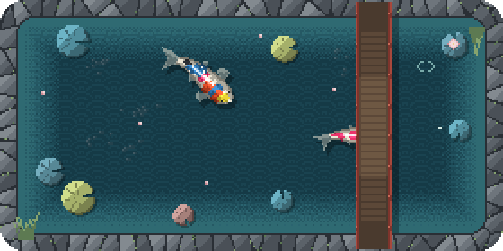
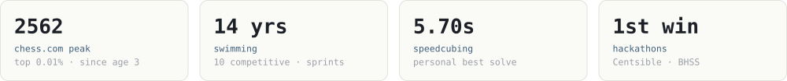
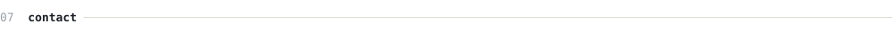

<!--
  Krishiv Vaid · GitHub profile
  Every image below is generated by code in this repository:
    assets/portrait-*                    scripts/generate_portrait.py  (image -> ASCII pipeline)
    assets/projects|sections|badges|...  scripts/generate_static.py
    output branch (koi pond + stats)     scripts/collect_github.py + generate_koi.py + generate_stats.py
                                         (daily, .github/workflows/update-profile.yml)
-->

<picture>
  <source media="(prefers-color-scheme: dark) and (max-width: 640px)" srcset="assets/portrait-dark-compact.svg">
  <source media="(max-width: 640px)" srcset="assets/portrait-light-compact.svg">
  <source media="(prefers-color-scheme: dark)" srcset="assets/portrait-dark.svg">
  
</picture>

  

<picture>
  <source media="(prefers-color-scheme: dark) and (max-width: 640px)" srcset="assets/sections/01-about-dark-compact.svg">
  <source media="(max-width: 640px)" srcset="assets/sections/01-about-light-compact.svg">
  <source media="(prefers-color-scheme: dark)" srcset="assets/sections/01-about-dark.svg">
  
</picture>

I study statistics and computer science at the **University of Waterloo**. Most of what I build sits where software meets numerics: simulators that are checked against conservation laws, a deep learning framework written from first principles in C++20, and production infrastructure for an open-source math platform used by 130,000+ students. On the research side I work on AI for mathematics at MIT CSAIL, after a summer of harmonic analysis at the University of Toronto.

The problems I keep coming back to are systems programming, distributed systems, ML infrastructure, and high-performance scientific computing. I like code whose correctness can be measured: tests that pin down the maths, benchmarks with stated hardware, and results anyone can reproduce.

 

<picture>
  <source media="(prefers-color-scheme: dark) and (max-width: 640px)" srcset="assets/sections/02-experience-dark-compact.svg">
  <source media="(max-width: 640px)" srcset="assets/sections/02-experience-light-compact.svg">
  <source media="(prefers-color-scheme: dark)" srcset="assets/sections/02-experience-dark.svg">
  
</picture>

**[USAMO Guide](https://usamoguide.com)** · Software Engineer 
Aug 2026 – present · Toronto, ON · TypeScript · React · Gatsby · Supabase · PostgreSQL

- Core infrastructure for an open-source olympiad math platform serving **130,000+ students** across **165 lessons** and a **31,000+ problem** bank.
- React/Gatsby + TypeScript frontend with Tailwind CSS; Supabase backend with Postgres row-level security, auth, and **7 edge functions** for groups and admin roles.
- Automated compilation of **429 Asymptote diagrams** to SVG; set up Vercel, Storybook, Lighthouse CI and linting.

**Waterloo Rocketry** · Software Engineer 
Sep 2026 – present · Waterloo, ON · React · TypeScript · telemetry · open source

- Ground-systems software for the University of Waterloo's student rocketry team, including a **live sensor-monitoring dashboard**.
- Typed, reusable React components that stream and chart live telemetry for operators during engine tests.
- Features shipped through code review in the team's open-source repositories, alongside the avionics and firmware sub-teams.

**Orangutany** · Machine Learning Engineer 
Apr – Aug 2026 · Toronto, ON · Node.js · Next.js · Capacitor · Python · computer vision

- Node.js backend for a computer-vision species-identification API that ranks the top-3 matches by confidence.
- Multi-photo validation that flags mixed-species uploads (top match < 90% or margin < 15 pts).
- Next.js/React + Capacitor iOS app (Turso, Google OAuth, Stripe) backed by **300 automated tests**; a **143-species** guide built on Python/PIL image curation and GBIF range-map pipelines.

&nbsp;

<b>research</b>

**MIT CSAIL** · Researcher, AI for Science & Mathematics 
Nov 2026 – present · formal proof · machine learning

- Getting machine learning models to write proofs that can actually be checked, starting with formalisation: restating a problem in a proof assistant so a computer verifies every step.
- Studying how models search for proofs in that setting, where the answer is never fuzzy: the proof either checks or it doesn't.

**University of Toronto**, Department of Mathematics · Research Assistant, Harmonic Analysis 
Jun – Sep 2026 · Toronto, ON · Fourier analysis · NumPy

- Investigated Lp bounds for maximal averages with Littlewood–Paley and Calderón–Zygmund methods.
- Surveyed **40+ papers** on Fourier restriction; wrote NumPy checks of conjectured decay rates for oscillatory integrals.

**STEMinate** · Research Intern, Brain–Computer Interfaces 
Apr – Aug 2025 · Toronto, ON · neurotechnology · neuroethics

- Sole author of *[Dream Engineering](https://doi.org/10.5281/zenodo.24373952)* (**50 sources**), guided by researchers from Neuralink and the University of Michigan.
- Proposed a consent-based, closed-loop dream-intervention system and a pilot study to test it; analysed UNESCO's neurotechnology ethics guidance.

 

<picture>
  <source media="(prefers-color-scheme: dark) and (max-width: 640px)" srcset="assets/sections/03-projects-dark-compact.svg">
  <source media="(max-width: 640px)" srcset="assets/sections/03-projects-light-compact.svg">
  <source media="(prefers-color-scheme: dark)" srcset="assets/sections/03-projects-dark.svg">
  
</picture>

<a href="https://github.com/Krishiv-Vaid/double-pendulum">
<picture>
  <source media="(prefers-color-scheme: dark) and (max-width: 640px)" srcset="assets/projects/double-pendulum-dark-compact.svg">
  <source media="(max-width: 640px)" srcset="assets/projects/double-pendulum-light-compact.svg">
  <source media="(prefers-color-scheme: dark)" srcset="assets/projects/double-pendulum-dark.svg">
  
</picture>
</a>

  <a href="https://github.com/Krishiv-Vaid/double-pendulum/blob/main/pyproject.toml">=3.10"></a>
  
  
  
  
   &nbsp;<a href="https://github.com/Krishiv-Vaid/double-pendulum">repository</a> · <a href="https://krishiv-vaid.github.io/double-pendulum/">live demo</a> · benchmarks: Apple M4, Python 3.14 · card trace is a real RK4 run

 

<a href="https://github.com/Krishiv-Vaid/centsible">
<picture>
  <source media="(prefers-color-scheme: dark) and (max-width: 640px)" srcset="assets/projects/centsible-dark-compact.svg">
  <source media="(max-width: 640px)" srcset="assets/projects/centsible-light-compact.svg">
  <source media="(prefers-color-scheme: dark)" srcset="assets/projects/centsible-dark.svg">
  
</picture>
</a>

  
  
  
  
  
   &nbsp;<a href="https://github.com/Krishiv-Vaid/centsible">repository</a> · <a href="https://centsible-ca.netlify.app/">live app</a> · my first hackathon win

&nbsp;all public repositories

 

| repository | | status |
|:--|:--|:--|
| [`double-pendulum`](https://github.com/Krishiv-Vaid/double-pendulum) | chaos laboratory for the double pendulum; dashboard runs in the browser via Pyodide | active · [demo](https://krishiv-vaid.github.io/double-pendulum/) |
| [`centsible`](https://github.com/Krishiv-Vaid/centsible) | savings planner for teens in Ontario · BHSS hackathon winner | live · [app](https://centsible-ca.netlify.app/) |
| [`tinytorch`](https://github.com/Krishiv-Vaid/tinytorch) | deep learning framework in C++20: strided tensors, reverse-mode autodiff, AVX2 kernels | in progress |
| [`personal-website`](https://github.com/Krishiv-Vaid/personal-website) | portfolio at [krishvaid.me](https://krishvaid.me): static HTML/CSS/JS, light and dark themes | live |
| [`endgame`](https://github.com/Krishiv-Vaid/endgame) | chess engine in C++20: bitboard move generation, alpha-beta search, NNUE evaluation | planned |
| [`keyecho`](https://github.com/Krishiv-Vaid/keyecho) | research into keyboard acoustic side channels with DSP and deep learning | planned |
| [`neuroscan`](https://github.com/Krishiv-Vaid/neuroscan) | intracranial hemorrhage detection from volumetric CT, with uncertainty quantification | planned |
| [`Krishiv-Vaid`](https://github.com/Krishiv-Vaid/Krishiv-Vaid) | this profile: ASCII portrait pipeline, koi pond, live stats, all generated | daily |

"in progress" and "planned" repositories don't contain code yet.

 

<picture>
  <source media="(prefers-color-scheme: dark) and (max-width: 640px)" srcset="assets/sections/04-toolkit-dark-compact.svg">
  <source media="(max-width: 640px)" srcset="assets/sections/04-toolkit-light-compact.svg">
  <source media="(prefers-color-scheme: dark)" srcset="assets/sections/04-toolkit-dark.svg">
  
</picture>

<picture>
  <source media="(prefers-color-scheme: dark) and (max-width: 640px)" srcset="assets/toolkit-dark-compact.svg">
  <source media="(max-width: 640px)" srcset="assets/toolkit-light-compact.svg">
  <source media="(prefers-color-scheme: dark)" srcset="assets/toolkit-dark.svg">
  
</picture>

  

<picture>
  <source media="(prefers-color-scheme: dark) and (max-width: 640px)" srcset="assets/sections/05-koi-dark-compact.svg">
  <source media="(max-width: 640px)" srcset="assets/sections/05-koi-light-compact.svg">
  <source media="(prefers-color-scheme: dark)" srcset="assets/sections/05-koi-dark.svg">
  
</picture>

  

<picture>
  <source media="(prefers-color-scheme: dark) and (max-width: 640px)" srcset="https://raw.githubusercontent.com/Krishiv-Vaid/Krishiv-Vaid/output/stats-dark-compact.svg">
  <source media="(max-width: 640px)" srcset="https://raw.githubusercontent.com/Krishiv-Vaid/Krishiv-Vaid/output/stats-light-compact.svg">
  <source media="(prefers-color-scheme: dark)" srcset="https://raw.githubusercontent.com/Krishiv-Vaid/Krishiv-Vaid/output/stats-dark.svg">
  
</picture>

&nbsp;how the koi grows

 

The pond is pixel art, drawn at 210 × 106 native pixels by [`generate_koi.py`](scripts/generate_koi.py) and scaled 4× with nearest-neighbour sampling so every pixel stays crisp. It's fed by my contributions over a **rolling 365-day window**, minus commits to this profile repository, which are mostly asset regeneration. The koi's length follows a concave curve, `g = min(1, (c / 2800)^0.45)`, so **every contribution makes it a little bigger**. Early contributions grow it fastest.

| age class | contributions | what changes |
|:--|:--|:--|
| 01 Fry | 0+ | small, plain body, one patch |
| 02 Tosai | 100+ | second patch, pelvic fins, longer fins |
| 03 Nisai | 400+ | spots in my second language's colour, the first lotus blooms |
| 04 Sansai | 1,000+ | butterfly fins, sparkling gin-rin scales |
| 05 Jumbo | 2,200+ | full pattern, flowing fins, more lotus |

- **Languages:** each of the seven lily pads stands for a share of my code (bytes in owned public non-fork repositories, markup excluded) and takes that language's [linguist](https://github.com/github-linguist/linguist) colour. The koi's patches use my top language's colour.
- **Movement:** the koi swims a closed Fourier curve. Its spine follows the path by arc length, so its body bends through turns, with a travelling tail-beat wave and flapping fins on top. The route is re-seeded every day, so it wanders somewhere new each time, while the 24-second animation still loops seamlessly.
- **Automation:** the workflow runs daily and publishes only changed files to the [`output`](https://github.com/Krishiv-Vaid/Krishiv-Vaid/tree/output) branch, so `main` gets no bot commits.

The idea of a creature that grows from your GitHub activity comes from [Git Tulkun](https://github.com/PramudithaN/git-tulkun) (MIT); see [THIRD_PARTY_NOTICES](THIRD_PARTY_NOTICES.md).

<picture>
  <source media="(prefers-color-scheme: dark)" srcset="docs/img/koi-stages-dark.png">
  
</picture>

 

<picture>
  <source media="(prefers-color-scheme: dark) and (max-width: 640px)" srcset="assets/sections/06-beyond-dark-compact.svg">
  <source media="(max-width: 640px)" srcset="assets/sections/06-beyond-light-compact.svg">
  <source media="(prefers-color-scheme: dark)" srcset="assets/sections/06-beyond-dark.svg">
  
</picture>

<picture>
  <source media="(prefers-color-scheme: dark) and (max-width: 640px)" srcset="assets/beyond-dark-compact.svg">
  <source media="(max-width: 640px)" srcset="assets/beyond-light-compact.svg">
  <source media="(prefers-color-scheme: dark)" srcset="assets/beyond-dark.svg">
  
</picture>

- **Chess.** I've played since I was 3. Top 0.01% on Chess.com, with a 2562 peak rating.
- **Swimming.** I've been swimming for 14 years and racing competitively for 10. Sprints are my favourite.
- **Hackathons.** I've only recently started doing hackathons. My first win was [Centsible](https://github.com/Krishiv-Vaid/centsible), at the BHSS hackathon.
- **Speedcubing.** 5.70 s personal best.
- **Mathematics.** Beyond research, I work through open problems for fun: small cases first, then a proof I check by hand.
- Also poker, Dota 2, table tennis, soccer, hiking and outdoor photography.

 

<picture>
  <source media="(prefers-color-scheme: dark) and (max-width: 640px)" srcset="assets/sections/07-contact-dark-compact.svg">
  <source media="(max-width: 640px)" srcset="assets/sections/07-contact-light-compact.svg">
  <source media="(prefers-color-scheme: dark)" srcset="assets/sections/07-contact-dark.svg">
  
</picture>

  <a href="mailto:kvaid@uwaterloo.ca"><code>kvaid@uwaterloo.ca</code></a>
  &nbsp;·&nbsp;
  <a href="https://krishvaid.me"><code>krishvaid.me</code></a>
  &nbsp;·&nbsp;
  <a href="https://www.linkedin.com/in/krishiv-vaid"><code>linkedin/krishiv-vaid</code></a>

The portrait, cards, koi pond and panels are generated by the code in this repository · <a href="docs/MAINTENANCE.md">how it works</a>

