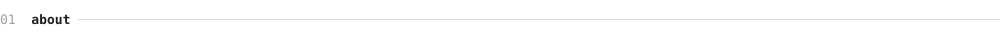
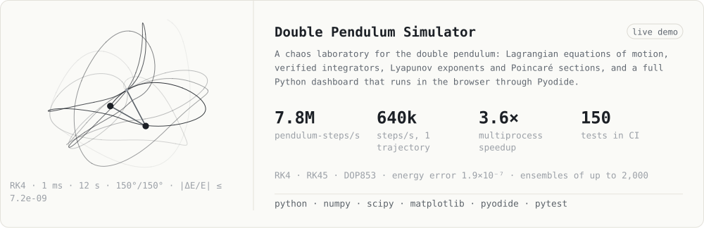
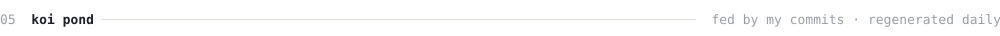
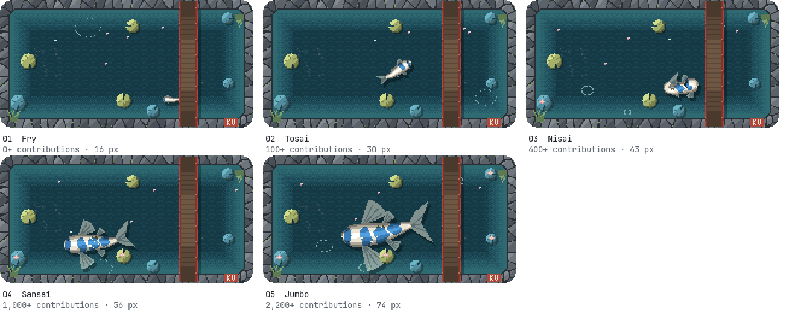

<!--
  Krishiv Vaid · GitHub profile
  Every image below is generated by code in this repository:
    assets/portrait-*                    scripts/generate_portrait.py  (image -> ASCII pipeline)
    assets/projects|sections|badges|...  scripts/generate_static.py
    output branch (koi pond + stats)     scripts/collect_github.py + generate_koi.py + generate_stats.py
                                         (daily, .github/workflows/update-profile.yml)
-->

<picture>
  <source media="(prefers-color-scheme: dark) and (max-width: 640px)" srcset="https://raw.githubusercontent.com/Krishiv-Vaid/Krishiv-Vaid/output/portrait-dark-compact.svg">
  <source media="(max-width: 640px)" srcset="https://raw.githubusercontent.com/Krishiv-Vaid/Krishiv-Vaid/output/portrait-light-compact.svg">
  <source media="(prefers-color-scheme: dark)" srcset="https://raw.githubusercontent.com/Krishiv-Vaid/Krishiv-Vaid/output/portrait-dark.svg">
  
</picture>

  

<picture>
  <source media="(prefers-color-scheme: dark) and (max-width: 640px)" srcset="assets/sections/01-about-dark-compact.svg">
  <source media="(max-width: 640px)" srcset="assets/sections/01-about-light-compact.svg">
  <source media="(prefers-color-scheme: dark)" srcset="assets/sections/01-about-dark.svg">
  
</picture>

I study computer science and statistics at the **University of Waterloo**.

I like building things where code and math meet: physics simulations, machine learning tools, and the web apps around them. Right now that means USAMO Guide, ground software for Waterloo Rocketry, and research on AI for mathematics at MIT CSAIL.

When I'm not coding, I'm usually playing chess, swimming, or stuck on a math problem.

 

<picture>
  <source media="(prefers-color-scheme: dark) and (max-width: 640px)" srcset="assets/sections/02-experience-dark-compact.svg">
  <source media="(max-width: 640px)" srcset="assets/sections/02-experience-light-compact.svg">
  <source media="(prefers-color-scheme: dark)" srcset="assets/sections/02-experience-dark.svg">
  
</picture>

**[USAMO Guide](https://usamoguide.com)** · Software Engineer 
Aug 2026 – present · Toronto, ON · TypeScript · React · Gatsby · Supabase · PostgreSQL

- Core infrastructure for an open-source olympiad math platform serving **130,000+ students** across **165 lessons** and a **31,000+ problem** bank.
- React/Gatsby + TypeScript frontend with Tailwind CSS; Supabase backend with Postgres row-level security, auth, and **7 edge functions** for groups and admin roles.
- Automated compilation of **429 Asymptote diagrams** to SVG; set up Vercel, Storybook, Lighthouse CI and linting.

**[Waterloo Rocketry](https://www.waterloorocketry.com)** · Software Engineer 
Sep 2026 – present · Waterloo, ON · React · TypeScript · telemetry · open source

- Ground-systems software for the University of Waterloo's student rocketry team, including a **live sensor-monitoring dashboard**.
- Typed, reusable React components that stream and chart live telemetry for operators during engine tests.
- Features shipped through code review in the team's open-source repositories, alongside the avionics and firmware sub-teams.

**Orangutany** · Machine Learning Engineer 
Apr – Aug 2026 · Toronto, ON · Node.js · Next.js · Capacitor · Python · computer vision

- Node.js backend for a computer-vision species-identification API that ranks the top-3 matches by confidence.
- Multi-photo validation that flags mixed-species uploads (top match < 90% or margin < 15 pts).
- Next.js/React + Capacitor iOS app (Turso, Google OAuth, Stripe) backed by **300 automated tests**; a **143-species** guide built on Python/PIL image curation and GBIF range-map pipelines.

&nbsp;

<b>research</b>

**[MIT CSAIL](https://www.csail.mit.edu)** · Researcher, AI for Science & Mathematics 
Nov 2026 – present · formal proof · machine learning

- Formalising math problems in a proof assistant so that proofs written by machine learning models can be checked by a computer.
- Studying how language models search for proofs in formal systems.

**[University of Toronto, Department of Mathematics](https://www.math.toronto.edu)** · Research Assistant, Harmonic Analysis 
Jun – Sep 2026 · Toronto, ON · Fourier analysis · NumPy

- Investigated Lp bounds for maximal averages with Littlewood–Paley and Calderón–Zygmund methods.
- Surveyed **40+ papers** on Fourier restriction; wrote NumPy checks of conjectured decay rates for oscillatory integrals.

**STEMinate** · Research Intern, Brain–Computer Interfaces 
Apr – Aug 2025 · Toronto, ON · neurotechnology · neuroethics

- Sole author of *[Dream Engineering](https://doi.org/10.5281/zenodo.24373952)* (**50 sources**), guided by researchers from Neuralink and the University of Michigan.
- Proposed a consent-based, closed-loop dream-intervention system and a pilot study to test it; analysed UNESCO's neurotechnology ethics guidance.

 

<picture>
  <source media="(prefers-color-scheme: dark) and (max-width: 640px)" srcset="assets/sections/03-projects-dark-compact.svg">
  <source media="(max-width: 640px)" srcset="assets/sections/03-projects-light-compact.svg">
  <source media="(prefers-color-scheme: dark)" srcset="assets/sections/03-projects-dark.svg">
  
</picture>

<a href="https://github.com/Krishiv-Vaid/double-pendulum">
<picture>
  <source media="(prefers-color-scheme: dark) and (max-width: 640px)" srcset="assets/projects/double-pendulum-dark-compact.svg">
  <source media="(max-width: 640px)" srcset="assets/projects/double-pendulum-light-compact.svg">
  <source media="(prefers-color-scheme: dark)" srcset="assets/projects/double-pendulum-dark.svg">
  
</picture>
</a>

  <a href="https://github.com/Krishiv-Vaid/double-pendulum/blob/main/pyproject.toml">=3.10"></a>
  
  
  
  
   &nbsp;<a href="https://github.com/Krishiv-Vaid/double-pendulum">repository</a> · <a href="https://krishiv-vaid.github.io/double-pendulum/">live demo</a> · benchmarks: Apple M4, Python 3.14 · card trace is a real RK4 run

 

<a href="https://github.com/Krishiv-Vaid/centsible">
<picture>
  <source media="(prefers-color-scheme: dark) and (max-width: 640px)" srcset="assets/projects/centsible-dark-compact.svg">
  <source media="(max-width: 640px)" srcset="assets/projects/centsible-light-compact.svg">
  <source media="(prefers-color-scheme: dark)" srcset="assets/projects/centsible-dark.svg">
  
</picture>
</a>

  
  
  
  
  
   &nbsp;<a href="https://github.com/Krishiv-Vaid/centsible">repository</a> · <a href="https://centsible-ca.netlify.app/">live app</a> · my first hackathon win

&nbsp;all public repositories

 

| repository | | status |
|:--|:--|:--|
| [`double-pendulum`](https://github.com/Krishiv-Vaid/double-pendulum) | chaos laboratory for the double pendulum; dashboard runs in the browser via Pyodide | active · [demo](https://krishiv-vaid.github.io/double-pendulum/) |
| [`centsible`](https://github.com/Krishiv-Vaid/centsible) | savings planner for teens in Ontario · BHSS hackathon winner | live · [app](https://centsible-ca.netlify.app/) |
| [`tinytorch`](https://github.com/Krishiv-Vaid/tinytorch) | deep learning framework in C++20: strided tensors, reverse-mode autodiff, AVX2 kernels | in progress |
| [`personal-website`](https://github.com/Krishiv-Vaid/personal-website) | portfolio at [krishvaid.me](https://krishvaid.me): static HTML/CSS/JS, light and dark themes | live |
| [`endgame`](https://github.com/Krishiv-Vaid/endgame) | chess engine in C++20: bitboard move generation, alpha-beta search, NNUE evaluation | planned |
| [`keyecho`](https://github.com/Krishiv-Vaid/keyecho) | research into keyboard acoustic side channels with DSP and deep learning | planned |
| [`neuroscan`](https://github.com/Krishiv-Vaid/neuroscan) | intracranial hemorrhage detection from volumetric CT, with uncertainty quantification | planned |
| [`Krishiv-Vaid`](https://github.com/Krishiv-Vaid/Krishiv-Vaid) | this profile: ASCII portrait pipeline, koi pond, live stats, all generated | daily |

"in progress" and "planned" repositories don't contain code yet.

 

<picture>
  <source media="(prefers-color-scheme: dark) and (max-width: 640px)" srcset="assets/sections/04-toolkit-dark-compact.svg">
  <source media="(max-width: 640px)" srcset="assets/sections/04-toolkit-light-compact.svg">
  <source media="(prefers-color-scheme: dark)" srcset="assets/sections/04-toolkit-dark.svg">
  
</picture>

<picture>
  <source media="(prefers-color-scheme: dark) and (max-width: 640px)" srcset="assets/toolkit-dark-compact.svg">
  <source media="(max-width: 640px)" srcset="assets/toolkit-light-compact.svg">
  <source media="(prefers-color-scheme: dark)" srcset="assets/toolkit-dark.svg">
  
</picture>

  

<picture>
  <source media="(prefers-color-scheme: dark) and (max-width: 640px)" srcset="assets/sections/05-koi-dark-compact.svg">
  <source media="(max-width: 640px)" srcset="assets/sections/05-koi-light-compact.svg">
  <source media="(prefers-color-scheme: dark)" srcset="assets/sections/05-koi-dark.svg">
  
</picture>

  

<picture>
  <source media="(prefers-color-scheme: dark) and (max-width: 640px)" srcset="https://raw.githubusercontent.com/Krishiv-Vaid/Krishiv-Vaid/output/stats-dark-compact.svg">
  <source media="(max-width: 640px)" srcset="https://raw.githubusercontent.com/Krishiv-Vaid/Krishiv-Vaid/output/stats-light-compact.svg">
  <source media="(prefers-color-scheme: dark)" srcset="https://raw.githubusercontent.com/Krishiv-Vaid/Krishiv-Vaid/output/stats-dark.svg">
  
</picture>

&nbsp;how the koi grow

 

The pond is pixel art, drawn at 280 × 140 native pixels by [`generate_koi.py`](scripts/generate_koi.py) and scaled 3× with nearest-neighbour sampling, so it shows 1:1 at 840 px and every pixel stays crisp. It's fed by **every contribution I've made**, in order:

- **Every 100 contributions raise one koi.** Contributions 1–100 raise the first koi, 101–200 the second, and so on.
- **Each contribution makes the growing koi a little bigger.** It goes from fry (Fry → Tosai → Nisai) to adult over its 100. Adults are all roughly the same size, so the pond stays in proportion.
- **Every 10 contributions paint a patch** in the colour of the language they were written in ([linguist](https://github.com/github-linguist/linguist) colours, made a little more vivid). Each single contribution grows the patch in progress. Private work and repositories without code yet show as black markings.
- **At 100 the koi is fully grown.** Its markings are frozen, its fins get longer, gin-rin scales sparkle and a lotus blooms. Then a new fry hatches.
- **Lily pads** are the languages I write the most, one pad per share of code (bytes in owned public non-fork repositories, markup excluded).
- **Routes change every day.** Each koi swims its own closed Fourier curve, re-seeded daily, with its spine following the path by arc length so its body bends through turns. The 24-second animation still loops seamlessly.

The idea of a creature that grows from your GitHub activity comes from [Git Tulkun](https://github.com/PramudithaN/git-tulkun) (MIT); see [THIRD_PARTY_NOTICES](THIRD_PARTY_NOTICES.md).

<picture>
  <source media="(prefers-color-scheme: dark)" srcset="docs/img/koi-stages-dark.png">
  
</picture>

 

<picture>
  <source media="(prefers-color-scheme: dark) and (max-width: 640px)" srcset="assets/sections/06-beyond-dark-compact.svg">
  <source media="(max-width: 640px)" srcset="assets/sections/06-beyond-light-compact.svg">
  <source media="(prefers-color-scheme: dark)" srcset="assets/sections/06-beyond-dark.svg">
  
</picture>

<picture>
  <source media="(prefers-color-scheme: dark) and (max-width: 640px)" srcset="assets/beyond-dark-compact.svg">
  <source media="(max-width: 640px)" srcset="assets/beyond-light-compact.svg">
  <source media="(prefers-color-scheme: dark)" srcset="assets/beyond-dark.svg">
  
</picture>

&nbsp;

- **Chess.** I've played since I was 3. Top 0.01% on Chess.com, with a 2562 peak rating.
- **Swimming.** I've been swimming for 14 years and racing competitively for 10. Sprints are my favourite.
- **Hackathons.** I've only recently started doing hackathons. My first win was [Centsible](https://github.com/Krishiv-Vaid/centsible), at the BHSS hackathon.
- **Speedcubing.** 5.70 s personal best.
- **Mathematics.** Beyond research, I work through open problems for fun: small cases first, then a proof I check by hand.
- Also poker, Dota 2, table tennis, soccer, hiking and outdoor photography.

 

<picture>
  <source media="(prefers-color-scheme: dark) and (max-width: 640px)" srcset="assets/sections/07-contact-dark-compact.svg">
  <source media="(max-width: 640px)" srcset="assets/sections/07-contact-light-compact.svg">
  <source media="(prefers-color-scheme: dark)" srcset="assets/sections/07-contact-dark.svg">
  
</picture>

  <a href="mailto:kvaid@uwaterloo.ca"><code>kvaid@uwaterloo.ca</code></a>
  &nbsp;·&nbsp;
  <a href="https://krishvaid.me"><code>krishvaid.me</code></a>
  &nbsp;·&nbsp;
  <a href="https://www.linkedin.com/in/krishiv-vaid"><code>linkedin/krishiv-vaid</code></a>

The portrait, cards, koi pond and panels are generated by the code in this repository · <a href="docs/MAINTENANCE.md">how it works</a>

