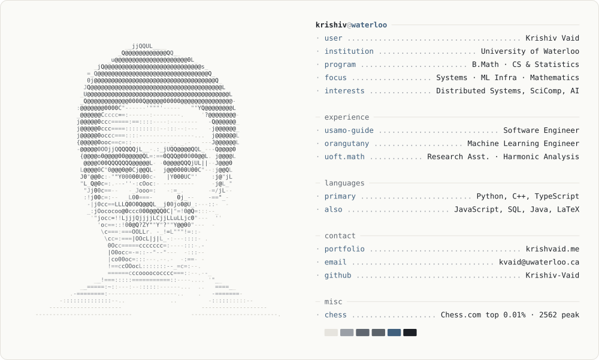
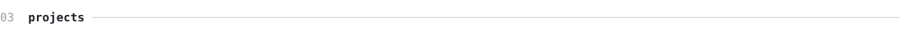
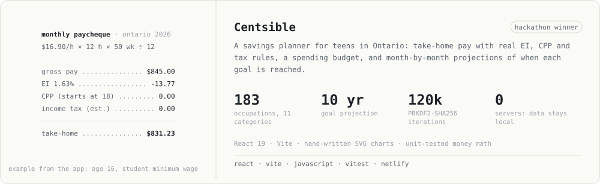
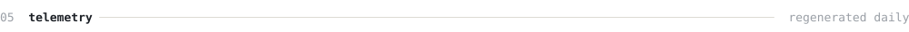
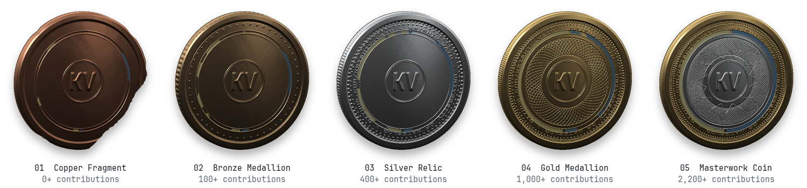

<!--
  Krishiv Vaid · GitHub profile
  Every image below is generated by code in this repository:
    assets/portrait-*      scripts/generate_portrait.py   (image -> ASCII pipeline)
    assets/projects|sections|toolkit-*   scripts/generate_static.py
    output branch          scripts/collect_github.py + generate_coin.py + generate_stats.py
                           (daily, .github/workflows/update-profile.yml)
-->

<picture>
  <source media="(prefers-color-scheme: dark) and (max-width: 640px)" srcset="assets/portrait-dark-compact.svg">
  <source media="(max-width: 640px)" srcset="assets/portrait-light-compact.svg">
  <source media="(prefers-color-scheme: dark)" srcset="assets/portrait-dark.svg">
  
</picture>

  

<picture>
  <source media="(prefers-color-scheme: dark) and (max-width: 640px)" srcset="assets/sections/01-about-dark-compact.svg">
  <source media="(max-width: 640px)" srcset="assets/sections/01-about-light-compact.svg">
  <source media="(prefers-color-scheme: dark)" srcset="assets/sections/01-about-dark.svg">
  
</picture>

I study mathematics and computer science at the **University of Waterloo** (B.Math, Computer Science & Statistics). Most of what I build sits where software meets numerics: simulators that are checked against conservation laws, a deep learning framework written from first principles in C++20, and production infrastructure for an open-source math platform used by 130,000+ students. On the research side I work in harmonic analysis, on Lp bounds for maximal averages.

The problems I keep coming back to are systems programming, distributed systems, ML infrastructure, and high-performance scientific computing. I like code whose correctness can be measured: tests that pin down the maths, benchmarks with stated hardware, and results anyone can reproduce.

 

<picture>
  <source media="(prefers-color-scheme: dark) and (max-width: 640px)" srcset="assets/sections/02-experience-dark-compact.svg">
  <source media="(max-width: 640px)" srcset="assets/sections/02-experience-light-compact.svg">
  <source media="(prefers-color-scheme: dark)" srcset="assets/sections/02-experience-dark.svg">
  
</picture>

**[USAMO Guide](https://usamoguide.com)** · Software Engineer 
Aug 2026 – present · Toronto, ON · TypeScript · React · Gatsby · Supabase · PostgreSQL

- Core infrastructure for an open-source olympiad math platform serving **130,000+ students** across **165 lessons** and a **31,000+ problem** bank.
- React/Gatsby + TypeScript frontend with Tailwind CSS; Supabase backend with Postgres row-level security, auth, and **7 edge functions** for groups and admin roles.
- Automated compilation of **429 Asymptote diagrams** to SVG; set up Vercel, Storybook, Lighthouse CI and linting.

**Orangutany** · Machine Learning Engineer 
Apr – Aug 2026 · Toronto, ON · Node.js · Next.js · Capacitor · Python · computer vision

- Node.js backend for a computer-vision species-identification API that ranks the top-3 matches by confidence.
- Multi-photo validation that flags mixed-species uploads (top match < 90% or margin < 15 pts).
- Next.js/React + Capacitor iOS app (Turso, Google OAuth, Stripe) backed by **300 automated tests**; a **143-species** guide built on Python/PIL image curation and GBIF range-map pipelines.

**University of Toronto**, Department of Mathematics · Research Assistant, Harmonic Analysis 
Jun – Sep 2026 · Toronto, ON · Fourier analysis · NumPy

- Investigated Lp bounds for maximal averages with Littlewood–Paley and Calderón–Zygmund methods.
- Surveyed **40+ papers** on Fourier restriction; wrote NumPy checks of conjectured decay rates for oscillatory integrals.

 

<picture>
  <source media="(prefers-color-scheme: dark) and (max-width: 640px)" srcset="assets/sections/03-projects-dark-compact.svg">
  <source media="(max-width: 640px)" srcset="assets/sections/03-projects-light-compact.svg">
  <source media="(prefers-color-scheme: dark)" srcset="assets/sections/03-projects-dark.svg">
  
</picture>

<a href="https://github.com/Krishiv-Vaid/double-pendulum">
<picture>
  <source media="(prefers-color-scheme: dark) and (max-width: 640px)" srcset="assets/projects/double-pendulum-dark-compact.svg">
  <source media="(max-width: 640px)" srcset="assets/projects/double-pendulum-light-compact.svg">
  <source media="(prefers-color-scheme: dark)" srcset="assets/projects/double-pendulum-dark.svg">
  
</picture>
</a>

&nbsp;<a href="https://github.com/Krishiv-Vaid/double-pendulum">repository</a> · <a href="https://krishiv-vaid.github.io/double-pendulum/">live demo</a> · benchmarks: Apple M4, Python 3.14 · card trace is a real RK4 run

 

<a href="https://github.com/Krishiv-Vaid/tinytorch">
<picture>
  <source media="(prefers-color-scheme: dark) and (max-width: 640px)" srcset="assets/projects/tinytorch-dark-compact.svg">
  <source media="(max-width: 640px)" srcset="assets/projects/tinytorch-light-compact.svg">
  <source media="(prefers-color-scheme: dark)" srcset="assets/projects/tinytorch-dark.svg">
  
</picture>
</a>

&nbsp;<a href="https://github.com/Krishiv-Vaid/tinytorch">repository</a> · under active development: design goals shown, no benchmarks claimed yet

 

<a href="https://github.com/Krishiv-Vaid/centsible">
<picture>
  <source media="(prefers-color-scheme: dark) and (max-width: 640px)" srcset="assets/projects/centsible-dark-compact.svg">
  <source media="(max-width: 640px)" srcset="assets/projects/centsible-light-compact.svg">
  <source media="(prefers-color-scheme: dark)" srcset="assets/projects/centsible-dark.svg">
  
</picture>
</a>

&nbsp;<a href="https://github.com/Krishiv-Vaid/centsible">repository</a> · <a href="https://centsible-ca.netlify.app/">live app</a> · winner, BHSS hackathon

&nbsp;other public repositories

 

| repository | | status |
|:--|:--|:--|
| [`personal-website`](https://github.com/Krishiv-Vaid/personal-website) | portfolio at [krishvaid.me](https://krishvaid.me): static HTML/CSS/JS, light and dark themes | live |
| [`endgame`](https://github.com/Krishiv-Vaid/endgame) | chess engine in C++20: bitboard move generation, alpha-beta search, NNUE evaluation | planned |
| [`keyecho`](https://github.com/Krishiv-Vaid/keyecho) | research into keyboard acoustic side channels with DSP and deep learning | planned |
| [`neuroscan`](https://github.com/Krishiv-Vaid/neuroscan) | intracranial hemorrhage detection from volumetric CT, with uncertainty quantification | planned |

"planned" repositories currently contain a README only.

 

<picture>
  <source media="(prefers-color-scheme: dark) and (max-width: 640px)" srcset="assets/sections/04-toolkit-dark-compact.svg">
  <source media="(max-width: 640px)" srcset="assets/sections/04-toolkit-light-compact.svg">
  <source media="(prefers-color-scheme: dark)" srcset="assets/sections/04-toolkit-dark.svg">
  
</picture>

<picture>
  <source media="(prefers-color-scheme: dark) and (max-width: 640px)" srcset="assets/toolkit-dark-compact.svg">
  <source media="(max-width: 640px)" srcset="assets/toolkit-light-compact.svg">
  <source media="(prefers-color-scheme: dark)" srcset="assets/toolkit-dark.svg">
  
</picture>

  

<picture>
  <source media="(prefers-color-scheme: dark) and (max-width: 640px)" srcset="assets/sections/05-telemetry-dark-compact.svg">
  <source media="(max-width: 640px)" srcset="assets/sections/05-telemetry-light-compact.svg">
  <source media="(prefers-color-scheme: dark)" srcset="assets/sections/05-telemetry-dark.svg">
  
</picture>

  

<picture>
  <source media="(prefers-color-scheme: dark) and (max-width: 640px)" srcset="https://raw.githubusercontent.com/Krishiv-Vaid/Krishiv-Vaid/output/stats-dark-compact.svg">
  <source media="(max-width: 640px)" srcset="https://raw.githubusercontent.com/Krishiv-Vaid/Krishiv-Vaid/output/stats-light-compact.svg">
  <source media="(prefers-color-scheme: dark)" srcset="https://raw.githubusercontent.com/Krishiv-Vaid/Krishiv-Vaid/output/stats-dark.svg">
  
</picture>

&nbsp;how the coin works

 

The coin is ray-cast frame by frame in NumPy by [`generate_coin.py`](scripts/generate_coin.py). Its input is my contribution count over a **rolling 365-day window**, minus commits to this profile repository, which are mostly asset regeneration. Growth follows a concave curve, `g = min(1, (c / 2800)^0.45)`: early contributions change the design quickly and later ones refine it. Detail also varies within a stage, so every contribution moves the design a little.

| stage | contributions | what changes |
|:--|:--|:--|
| 01 Copper Fragment | 0+ | broken edge, worn relief, chipped enamel |
| 02 Bronze Medallion | 100+ | full disc, bead ring, reeded edge |
| 03 Silver Relic | 400+ | denticles, raised legend ring, sharper polish |
| 04 Gold Medallion | 1,000+ | guilloché rosette, star lattice past mid-stage |
| 05 Masterwork Coin | 2,200+ | bimetallic platinum and gold, densest engraving |

The enamel band is split by my top languages (bytes in owned public non-fork repositories, markup excluded). Each [linguist](https://github.com/github-linguist/linguist) colour is pulled into a muted band and blended toward the coin's metal. The workflow runs daily and publishes only changed files to the [`output`](https://github.com/Krishiv-Vaid/Krishiv-Vaid/tree/output) branch, so `main` gets no bot commits. The concept is inspired by [Git Tulkun](https://github.com/PramudithaN/git-tulkun) (MIT); see [THIRD_PARTY_NOTICES](THIRD_PARTY_NOTICES.md).

<picture>
  <source media="(prefers-color-scheme: dark)" srcset="docs/img/coin-stages-dark.png">
  
</picture>

 

<picture>
  <source media="(prefers-color-scheme: dark) and (max-width: 640px)" srcset="assets/sections/06-beyond-dark-compact.svg">
  <source media="(max-width: 640px)" srcset="assets/sections/06-beyond-light-compact.svg">
  <source media="(prefers-color-scheme: dark)" srcset="assets/sections/06-beyond-dark.svg">
  
</picture>

- **Chess.** Top 0.01% on Chess.com, 2562 peak. I've played since I was three.
- **Swimming.** I swim competitively.
- **Hackathons.** Centsible won the BHSS hackathon.
- **Mathematics.** Research in harmonic analysis, plus open problems I work through for fun: small cases first, then a proof I check by hand.

 

<picture>
  <source media="(prefers-color-scheme: dark) and (max-width: 640px)" srcset="assets/sections/07-contact-dark-compact.svg">
  <source media="(max-width: 640px)" srcset="assets/sections/07-contact-light-compact.svg">
  <source media="(prefers-color-scheme: dark)" srcset="assets/sections/07-contact-dark.svg">
  
</picture>

  <a href="https://krishvaid.me"><code>krishvaid.me</code></a>
  &nbsp;·&nbsp;
  <a href="https://github.com/Krishiv-Vaid"><code>github/Krishiv-Vaid</code></a>
  &nbsp;·&nbsp;
  <a href="https://www.linkedin.com/in/krishiv-vaid"><code>linkedin/krishiv-vaid</code></a>
  &nbsp;·&nbsp;
  <a href="mailto:kvaid@uwaterloo.ca"><code>kvaid@uwaterloo.ca</code></a>

The portrait, cards, coin and panels are generated by the code in this repository · <a href="docs/MAINTENANCE.md">how it works</a>

