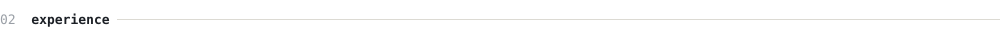
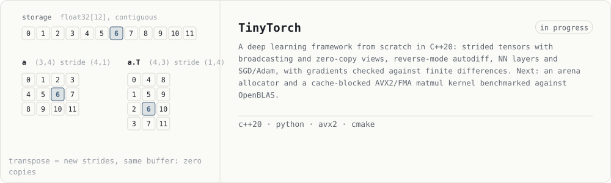
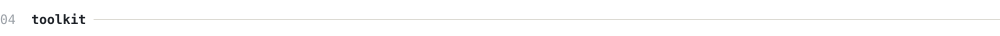
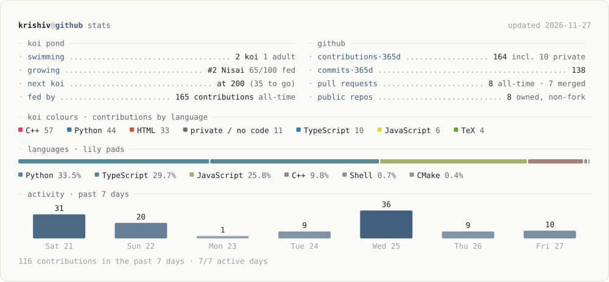
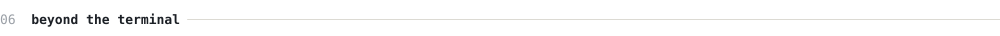

<!--
  Krishiv Vaid · GitHub profile
  Every image below is generated by code in this repository:
    assets/portrait-*                    scripts/generate_portrait.py  (image -> ASCII pipeline)
    assets/projects|sections|badges|...  scripts/generate_static.py
    output branch (koi pond + stats)     scripts/collect_github.py + generate_koi.py + generate_stats.py
                                         (daily, .github/workflows/update-profile.yml)
-->

<picture>
  <source media="(prefers-color-scheme: dark) and (max-width: 640px)" srcset="https://raw.githubusercontent.com/Krishiv-Vaid/Krishiv-Vaid/output/portrait-dark-compact.svg">
  <source media="(max-width: 640px)" srcset="https://raw.githubusercontent.com/Krishiv-Vaid/Krishiv-Vaid/output/portrait-light-compact.svg">
  <source media="(prefers-color-scheme: dark)" srcset="https://raw.githubusercontent.com/Krishiv-Vaid/Krishiv-Vaid/output/portrait-dark.svg">
  
</picture>

<picture>
  <source media="(prefers-color-scheme: dark) and (max-width: 640px)" srcset="https://raw.githubusercontent.com/Krishiv-Vaid/Krishiv-Vaid/main/assets/sections/01-about-dark-compact.svg">
  <source media="(max-width: 640px)" srcset="https://raw.githubusercontent.com/Krishiv-Vaid/Krishiv-Vaid/main/assets/sections/01-about-light-compact.svg">
  <source media="(prefers-color-scheme: dark)" srcset="https://raw.githubusercontent.com/Krishiv-Vaid/Krishiv-Vaid/main/assets/sections/01-about-dark.svg">
  
</picture>

I study computer science and statistics at the **University of Waterloo**.

I like building things where code and math meet: physics simulations, machine learning tools, and the web apps around them. Right now that means USAMO Guide, ground software for Waterloo Rocketry, and research on AI for mathematics at MIT CSAIL.

When I'm not coding, I'm usually playing chess, swimming, or stuck on a math problem.

**Every 100 GitHub contributions grow a new koi** in the [pond below](#koi-pond), painted in the colours of the languages I write.

 

<picture>
  <source media="(prefers-color-scheme: dark) and (max-width: 640px)" srcset="https://raw.githubusercontent.com/Krishiv-Vaid/Krishiv-Vaid/main/assets/sections/02-experience-dark-compact.svg">
  <source media="(max-width: 640px)" srcset="https://raw.githubusercontent.com/Krishiv-Vaid/Krishiv-Vaid/main/assets/sections/02-experience-light-compact.svg">
  <source media="(prefers-color-scheme: dark)" srcset="https://raw.githubusercontent.com/Krishiv-Vaid/Krishiv-Vaid/main/assets/sections/02-experience-dark.svg">
  
</picture>

- **[USAMO Guide](https://usamoguide.com)** · Software Engineer · infrastructure for an olympiad math platform used by 130,000+ students
- **[Waterloo Rocketry](https://www.waterloorocketry.com)** · Software Engineer · ground-systems software and live telemetry dashboards for engine tests
- **Orangutany** · Machine Learning Engineer · computer-vision species identification, from the Node.js API to an iOS app

<b>research</b>

- **[MIT CSAIL](https://www.csail.mit.edu)** · Researcher, AI for Science & Mathematics · formalising math so proofs written by models can be machine-checked
- **[University of Toronto, Department of Mathematics](https://www.math.toronto.edu)** · Research Assistant, Harmonic Analysis · Lp bounds for maximal averages
- **STEMinate** · Research Intern, Brain–Computer Interfaces · sole author of *[Dream Engineering](https://doi.org/10.5281/zenodo.24373952)*

Full details at [krishvaid.me](https://krishvaid.me).

 

<picture>
  <source media="(prefers-color-scheme: dark) and (max-width: 640px)" srcset="https://raw.githubusercontent.com/Krishiv-Vaid/Krishiv-Vaid/main/assets/sections/03-projects-dark-compact.svg">
  <source media="(max-width: 640px)" srcset="https://raw.githubusercontent.com/Krishiv-Vaid/Krishiv-Vaid/main/assets/sections/03-projects-light-compact.svg">
  <source media="(prefers-color-scheme: dark)" srcset="https://raw.githubusercontent.com/Krishiv-Vaid/Krishiv-Vaid/main/assets/sections/03-projects-dark.svg">
  
</picture>

<a href="https://github.com/Krishiv-Vaid/tinytorch">
<picture>
  <source media="(prefers-color-scheme: dark) and (max-width: 640px)" srcset="https://raw.githubusercontent.com/Krishiv-Vaid/Krishiv-Vaid/main/assets/projects/tinytorch-dark-compact.svg">
  <source media="(max-width: 640px)" srcset="https://raw.githubusercontent.com/Krishiv-Vaid/Krishiv-Vaid/main/assets/projects/tinytorch-light-compact.svg">
  <source media="(prefers-color-scheme: dark)" srcset="https://raw.githubusercontent.com/Krishiv-Vaid/Krishiv-Vaid/main/assets/projects/tinytorch-dark.svg">
  
</picture>
</a>

  
  
  
   &nbsp;<a href="https://github.com/Krishiv-Vaid/tinytorch">repository</a> · in progress, so no benchmarks yet · diagram: a transpose is a zero-copy view

 

<a href="https://github.com/Krishiv-Vaid/double-pendulum">
<picture>
  <source media="(prefers-color-scheme: dark) and (max-width: 640px)" srcset="https://raw.githubusercontent.com/Krishiv-Vaid/Krishiv-Vaid/main/assets/projects/double-pendulum-dark-compact.svg">
  <source media="(max-width: 640px)" srcset="https://raw.githubusercontent.com/Krishiv-Vaid/Krishiv-Vaid/main/assets/projects/double-pendulum-light-compact.svg">
  <source media="(prefers-color-scheme: dark)" srcset="https://raw.githubusercontent.com/Krishiv-Vaid/Krishiv-Vaid/main/assets/projects/double-pendulum-dark.svg">
  
</picture>
</a>

  <a href="https://github.com/Krishiv-Vaid/double-pendulum/blob/main/pyproject.toml">=3.10"></a>
  
  
  
  
   &nbsp;<a href="https://github.com/Krishiv-Vaid/double-pendulum">repository</a> · <a href="https://krishiv-vaid.github.io/double-pendulum/">live demo</a> · benchmarks: Apple M4, Python 3.14 · card trace is a real RK4 run

 

<a href="https://github.com/Krishiv-Vaid/centsible">
<picture>
  <source media="(prefers-color-scheme: dark) and (max-width: 640px)" srcset="https://raw.githubusercontent.com/Krishiv-Vaid/Krishiv-Vaid/main/assets/projects/centsible-dark-compact.svg">
  <source media="(max-width: 640px)" srcset="https://raw.githubusercontent.com/Krishiv-Vaid/Krishiv-Vaid/main/assets/projects/centsible-light-compact.svg">
  <source media="(prefers-color-scheme: dark)" srcset="https://raw.githubusercontent.com/Krishiv-Vaid/Krishiv-Vaid/main/assets/projects/centsible-dark.svg">
  
</picture>
</a>

  
  
  
  
  
   &nbsp;<a href="https://github.com/Krishiv-Vaid/centsible">repository</a> · <a href="https://centsible-ca.netlify.app/">live app</a> · my first hackathon win

&nbsp;all public repositories

 

| repository | | status |
|:--|:--|:--|
| [`double-pendulum`](https://github.com/Krishiv-Vaid/double-pendulum) | chaos laboratory for the double pendulum; dashboard runs in the browser via Pyodide | active · [demo](https://krishiv-vaid.github.io/double-pendulum/) |
| [`centsible`](https://github.com/Krishiv-Vaid/centsible) | savings planner for teens in Ontario · BHSS hackathon winner | live · [app](https://centsible-ca.netlify.app/) |
| [`tinytorch`](https://github.com/Krishiv-Vaid/tinytorch) | deep learning framework from scratch in C++20: strided tensors with zero-copy views, reverse-mode autodiff, NN layers and SGD/Adam checked against finite differences, and an AVX2/FMA matmul benchmarked against OpenBLAS | in progress |
| [`personal-website`](https://github.com/Krishiv-Vaid/personal-website) | source for [krishvaid.me](https://krishvaid.me): my work, research and projects in plain HTML, CSS and JavaScript (no framework, no build step), with light and dark themes and a visitor counter on a Cloudflare Worker | live |
| [`Krishiv-Vaid`](https://github.com/Krishiv-Vaid/Krishiv-Vaid) | this profile: ASCII portrait pipeline, koi pond, live stats, all generated | daily |

"in progress" repositories don't contain code yet.

 

<picture>
  <source media="(prefers-color-scheme: dark) and (max-width: 640px)" srcset="https://raw.githubusercontent.com/Krishiv-Vaid/Krishiv-Vaid/main/assets/sections/04-toolkit-dark-compact.svg">
  <source media="(max-width: 640px)" srcset="https://raw.githubusercontent.com/Krishiv-Vaid/Krishiv-Vaid/main/assets/sections/04-toolkit-light-compact.svg">
  <source media="(prefers-color-scheme: dark)" srcset="https://raw.githubusercontent.com/Krishiv-Vaid/Krishiv-Vaid/main/assets/sections/04-toolkit-dark.svg">
  
</picture>

<picture>
  <source media="(prefers-color-scheme: dark) and (max-width: 640px)" srcset="https://raw.githubusercontent.com/Krishiv-Vaid/Krishiv-Vaid/main/assets/toolkit-dark-compact.svg">
  <source media="(max-width: 640px)" srcset="https://raw.githubusercontent.com/Krishiv-Vaid/Krishiv-Vaid/main/assets/toolkit-light-compact.svg">
  <source media="(prefers-color-scheme: dark)" srcset="https://raw.githubusercontent.com/Krishiv-Vaid/Krishiv-Vaid/main/assets/toolkit-dark.svg">
  
</picture>

  

<picture>
  <source media="(prefers-color-scheme: dark) and (max-width: 640px)" srcset="https://raw.githubusercontent.com/Krishiv-Vaid/Krishiv-Vaid/main/assets/sections/05-koi-dark-compact.svg">
  <source media="(max-width: 640px)" srcset="https://raw.githubusercontent.com/Krishiv-Vaid/Krishiv-Vaid/main/assets/sections/05-koi-light-compact.svg">
  <source media="(prefers-color-scheme: dark)" srcset="https://raw.githubusercontent.com/Krishiv-Vaid/Krishiv-Vaid/main/assets/sections/05-koi-dark.svg">
  
</picture>

  

<picture>
  <source media="(prefers-color-scheme: dark) and (max-width: 640px)" srcset="https://raw.githubusercontent.com/Krishiv-Vaid/Krishiv-Vaid/output/stats-dark-compact.svg">
  <source media="(max-width: 640px)" srcset="https://raw.githubusercontent.com/Krishiv-Vaid/Krishiv-Vaid/output/stats-light-compact.svg">
  <source media="(prefers-color-scheme: dark)" srcset="https://raw.githubusercontent.com/Krishiv-Vaid/Krishiv-Vaid/output/stats-dark.svg">
  
</picture>

&nbsp;how the koi grow

 

The pond is pixel art, drawn at 280 × 140 native pixels by [`generate_koi.py`](scripts/generate_koi.py) and scaled 3× with nearest-neighbour sampling, so it shows 1:1 at 840 px and every pixel stays crisp. It's fed by **every contribution I've made**, in order:

- **Every 100 contributions raise one koi.** Contributions 1–100 raise the first koi, 101–200 the second, and so on.
- **Each contribution makes the growing koi a little bigger.** It goes from fry (Fry → Tosai → Nisai) to adult over its 100. Adults are all roughly the same size, so the pond stays in proportion.
- **Every 10 contributions paint a patch** in the colour of the language they were written in ([linguist](https://github.com/github-linguist/linguist) colours, made a little more vivid). Each single contribution grows the patch in progress. Private work and repositories without code yet show as black markings.
- **At 100 the koi is fully grown.** Its markings are frozen, its fins get longer, gin-rin scales sparkle and a lotus blooms. Then a new fry hatches.
- **Lily pads** are the languages I write the most, one pad per share of code (bytes in owned public non-fork repositories, markup excluded).
- **Routes change every day.** Each koi swims its own closed Fourier curve, re-seeded daily, with its spine following the path by arc length so its body bends through turns. The 24-second animation still loops seamlessly.

The idea of a creature that grows from your GitHub activity comes from [Git Tulkun](https://github.com/PramudithaN/git-tulkun) (MIT); see [THIRD_PARTY_NOTICES](THIRD_PARTY_NOTICES.md).

<picture>
  <source media="(prefers-color-scheme: dark)" srcset="https://raw.githubusercontent.com/Krishiv-Vaid/Krishiv-Vaid/main/docs/img/koi-stages-dark.png">
  
</picture>

 

<picture>
  <source media="(prefers-color-scheme: dark) and (max-width: 640px)" srcset="https://raw.githubusercontent.com/Krishiv-Vaid/Krishiv-Vaid/main/assets/sections/06-beyond-dark-compact.svg">
  <source media="(max-width: 640px)" srcset="https://raw.githubusercontent.com/Krishiv-Vaid/Krishiv-Vaid/main/assets/sections/06-beyond-light-compact.svg">
  <source media="(prefers-color-scheme: dark)" srcset="https://raw.githubusercontent.com/Krishiv-Vaid/Krishiv-Vaid/main/assets/sections/06-beyond-dark.svg">
  
</picture>

<picture>
  <source media="(prefers-color-scheme: dark) and (max-width: 640px)" srcset="https://raw.githubusercontent.com/Krishiv-Vaid/Krishiv-Vaid/main/assets/beyond-dark-compact.svg">
  <source media="(max-width: 640px)" srcset="https://raw.githubusercontent.com/Krishiv-Vaid/Krishiv-Vaid/main/assets/beyond-light-compact.svg">
  <source media="(prefers-color-scheme: dark)" srcset="https://raw.githubusercontent.com/Krishiv-Vaid/Krishiv-Vaid/main/assets/beyond-dark.svg">
  
</picture>

 

 

<picture>
  <source media="(prefers-color-scheme: dark) and (max-width: 640px)" srcset="https://raw.githubusercontent.com/Krishiv-Vaid/Krishiv-Vaid/main/assets/sections/07-contact-dark-compact.svg">
  <source media="(max-width: 640px)" srcset="https://raw.githubusercontent.com/Krishiv-Vaid/Krishiv-Vaid/main/assets/sections/07-contact-light-compact.svg">
  <source media="(prefers-color-scheme: dark)" srcset="https://raw.githubusercontent.com/Krishiv-Vaid/Krishiv-Vaid/main/assets/sections/07-contact-dark.svg">
  
</picture>

  <a href="mailto:kvaid@uwaterloo.ca"><code>kvaid@uwaterloo.ca</code></a>
  &nbsp;·&nbsp;
  <a href="https://krishvaid.me"><code>krishvaid.me</code></a>
  &nbsp;·&nbsp;
  <a href="https://www.linkedin.com/in/krishiv-vaid"><code>linkedin/krishiv-vaid</code></a>

The portrait, cards, koi pond and panels are generated by the code in this repository · <a href="docs/MAINTENANCE.md">how it works</a>

