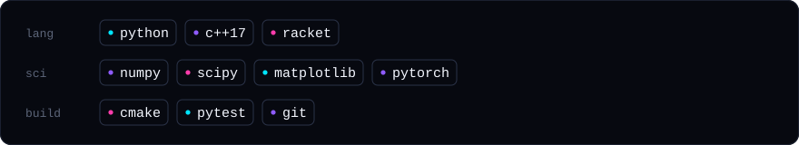

<p align="center">
  
  
</p>

<p align="center">
  I write integrators, autograd engines, and other code that checks its own work.
</p>

<br>

### `~/about`

<table>
<tr>
<td width="48%" valign="top">

```python
class Krishiv:
    school    = "UWaterloo"
    major     = "Applied Physics"
    minor     = "Computer Science"
    based_in  = "Toronto, ON"
    interests = ["hardware", "deep tech",
                 "physics", "AI"]

    # autograd from scratch;
    # tensor core moving to C++17
    currently_building = "lattice"

    def __repr__(self):
        return "physics -> silicon -> AI"
```

</td>
<td width="52%" align="center" valign="top">
  
  <br>
  <sub>Real geodesics, one ray bundle per digit. The left side is brighter because it's moving toward you. <a href="scripts/make_blackhole.py">source</a></sub>
</td>
</tr>
</table>

### `~/interests`

<p align="center">
  
</p>

<p align="center">
  
  <br>
  <sub>Adding harmonics never kills the ~9% overshoot at the edges (Gibbs). <a href="scripts/make_scope.py">source</a></sub>
</p>

### `~/stack`

<p align="center">
  
</p>

### `~/projects`

<table>
<tr>
<td width="44%" align="center" valign="top">
  <a href="https://github.com/Krishiv-Vaid/double-pendulum">
    
  </a>
</td>
<td width="56%" valign="top">

**[double-pendulum](https://github.com/Krishiv-Vaid/double-pendulum)**

Equations of motion from the Lagrangian, integrated with fixed-step RK4. Energy is tracked to prove the integrator isn't making things up: drift stays under 10⁻⁶ over 30 s of chaos.

The animation on the left is that integrator's actual output, baked into an SVG by [`make_pendulum.py`](scripts/make_pendulum.py). The script refuses to build if the drift claim stops being true.

<br>

**[lattice](https://github.com/Krishiv-Vaid/lattice)**

Reverse-mode autograd from the ground up: scalar `Value` → strided `Tensor` → `nn`, SGD/Adam, an MNIST MLP. Gradients are checked against finite differences and against PyTorch. Now porting the tensor core to C++17 with shared-storage views.

</td>
</tr>
</table>

<p align="center">
  <picture>
    <source media="(prefers-color-scheme: dark)" srcset="https://raw.githubusercontent.com/Krishiv-Vaid/Krishiv-Vaid/output/snake-dark.svg">
    
  </picture>
</p>

<br>

<p align="center">
  <a href="https://krishvaid.me">krishvaid.me</a> &nbsp;·&nbsp;
  <a href="https://linkedin.com/in/krishiv-vaid">linkedin</a> &nbsp;·&nbsp;
  <a href="https://x.com/krishiv_v22">x</a>
  <br><br>
  
</p>
